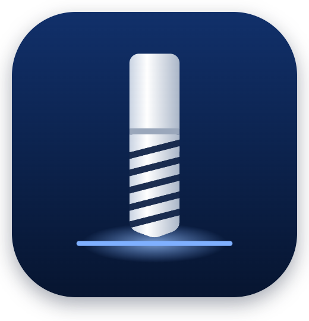
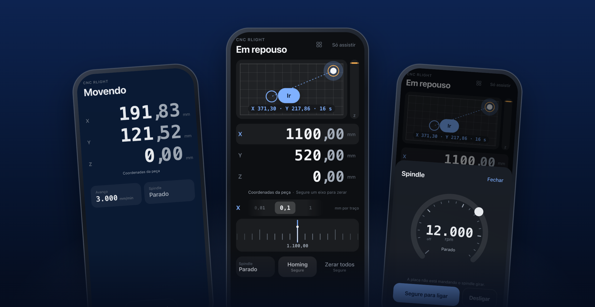
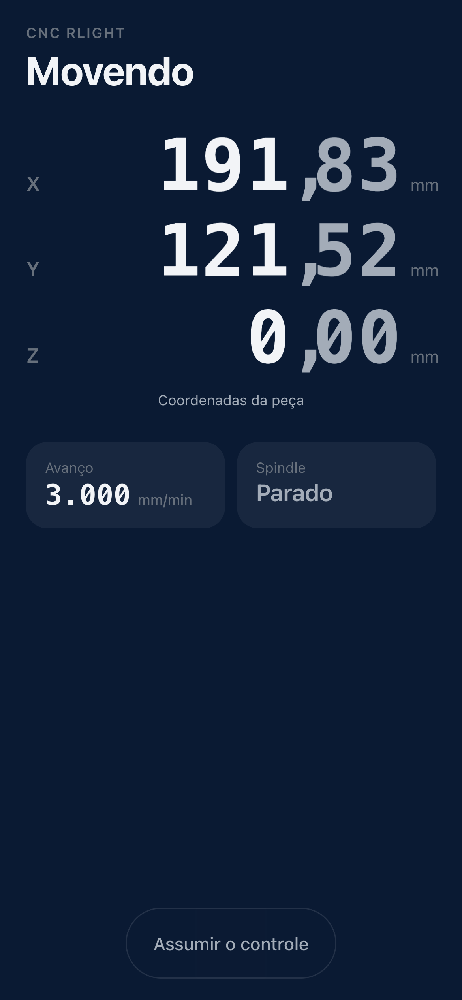
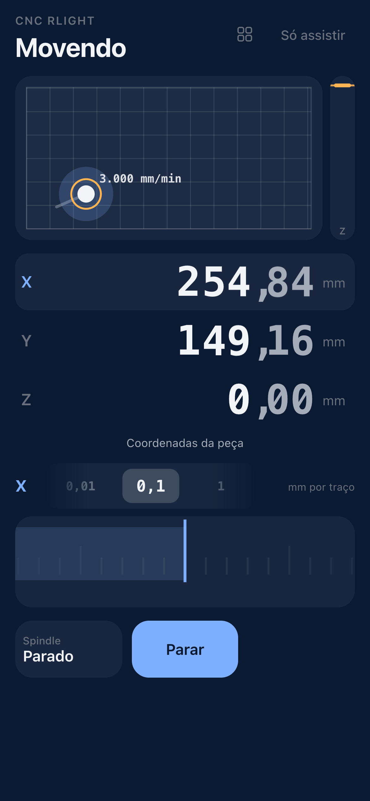
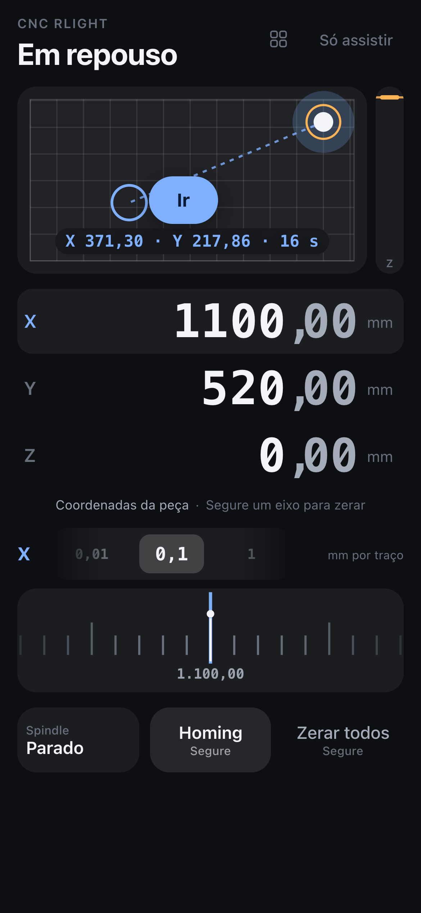
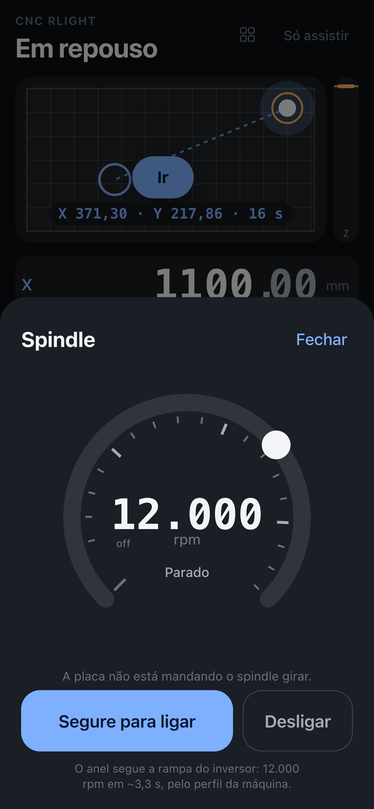
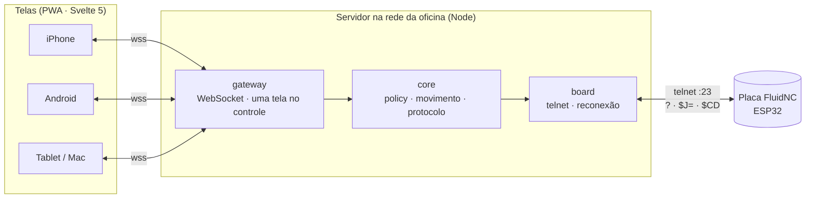

<p align="center">
  
</p>

<h1 align="center">RLight</h1>

<p align="center">
  <b>A sua CNC, ao vivo, na palma da mão.</b><br>
  Um app web para ver, mexer e confiar numa fresadora FluidNC, de qualquer celular da oficina.
</p>

<p align="center">
  <a href="https://github.com/willianrupert/rlight-pendant/actions/workflows/ci.yml"></a>
  
  
  
  <a href="LICENSE"></a>
</p>

<p align="center">
  <a href="https://willianrupert.github.io/rlight-pendant/"><b>▶ Experimente no navegador</b></a><br>
  <sub>Uma demonstração com a máquina simulada: a régua, o mapa com o Ir e o spindle, sem CNC nenhuma.</sub>
</p>

<p align="center">
  
</p>

As interfaces de CNC open source costumam ser painéis com todo parâmetro na tela e
todo erro em código. O RLight decide o que importa agora e esconde o resto atrás de
bons padrões. É um PWA servido na rede da oficina. Funciona no iPhone e no Android,
é grátis e não passa por loja.

**Funciona com qualquer máquina FluidNC.** O curso, os limites, as velocidades e o
spindle vêm da própria placa (`$CD`), e nenhum valor de máquina está no código. O
desenvolvimento e os testes são feitos numa fresadora real, a CNC RLight, que usa
o app no dia a dia.

## O que ele faz de diferente

<table>
<tr>
<td width="50%" valign="top">

**Uma régua em vez de botões de jog.** Arraste e a máquina acompanha o ritmo do
dedo. Dê um peteleco e ela segue por inércia, com o destino **anunciado** antes de
chegar. O passo (0,01 · 0,1 · 1 · 10 · 100 mm) muda a escala e a velocidade. A
régua só mostra os traços que a máquina alcança.

</td>
<td width="50%" valign="top">

**Toque na mesa e "Ir".** O mapa é a mesa em escala. Um toque põe um fantasma no
destino, com a linha do caminho. "Ir" manda um único movimento absoluto, na
velocidade máxima que a placa informa para os eixos. O alvo fica na mesa até a
máquina chegar, com **quanto falta, em segundos, diminuindo ao vivo**, calculado
com as rampas de aceleração da própria máquina.

</td>
</tr>
<tr>
<td valign="top">

**Números que deslizam sem mentir.** A posição desenhada interpola entre dois
relatórios da placa, sempre um relatório atrás e nunca prevendo. Os dígitos têm
largura fixa e os decimais ficam mais suaves, como num mostrador.

</td>
<td valign="top">

**Uma conexão honesta.** O Wi-Fi da placa fica dentro de um painel metálico e vai
falhar. A tela diz qual trecho caiu e há quanto tempo. Nada é enfileirado sem
sinal, e todo movimento é uma intenção completa e idempotente: se o celular some
no meio, a máquina termina onde devia ou para.

</td>
</tr>
<tr>
<td valign="top">

**Segurança por política, não por botão.** Cada comando passa pelo que o estado da
máquina permite (`allowed()`), no servidor. Uma tela por vez no controle; as outras
só assistem. Ações que não se desfazem pedem para segurar. O zero tem desfazer
por 30 s.

</td>
<td valign="top">

**O spindle pelo que a placa diz.** "Ligado" vem do campo `A:` do relatório, nunca
de rotação > 0. O anel sobe pela rampa real do inversor até a rotação escolhida, e
o app diz que isso é uma estimativa. Desligar funciona até no meio da espera do
spin-up do FluidNC.

</td>
</tr>
<tr>
<td valign="top">

**Automações, fora da tela de controle.** A placa de toque zera o Z sozinha: desce
rápido até encostar, recua, mede de novo devagar e zera pela espessura da placa.
É ali que vão morar as [receitas](docs/RECEITAS.md) do Romney Rupert, o CAM
conversacional que ele escreveu no Mach3.

</td>
<td valign="top">

**Feito para a oficina.** A tela não apaga com o controle nas mãos. Uma recusa
da placa vira uma frase, nunca um silêncio. O hodômetro conta quanto cada eixo
andou e quanto o spindle girou, hoje e desde sempre.

</td>
</tr>
</table>

## Telas

<table>
<tr>
<td align="center" width="25%"><br><sub><b>Assistir.</b> Quem não tem o controle vê a máquina ao vivo, sem nenhum botão perigoso.</sub></td>
<td align="center" width="25%"><br><sub><b>Controle.</b> O mapa com a velocidade real, a régua e o seletor de passo.</sub></td>
<td align="center" width="25%"><br><sub><b>Ir.</b> Um toque na mesa: o fantasma, o caminho e as coordenadas do destino.</sub></td>
<td align="center" width="25%"><br><sub><b>Spindle.</b> Gire para escolher e segure para ligar.</sub></td>
</tr>
</table>

## Medido na máquina, não suposto

Antes de cada decisão importante houve um spike na máquina de referência
(FluidNC v3.9.9, ESP32, Wi-Fi dentro do painel):

| Spike | O que provou | Resultado |
|---|---|---|
| [S1 · o elo](spikes/s1-elo/RESULTADO-2026-10-17.md) | A placa aguenta um cliente permanente por Wi-Fi? | 1 hora, **0 quedas**, 9,9 relatórios/s, resposta mediana de 28 ms. O limiar de "sem sinal" foi para 2,5 s com base nas pausas medidas |
| [S2 · o movimento](spikes/s2-movimento/RESULTADO-2026-10-17.md) | O celular pode sumir no meio de um movimento? | **10/10** terminaram no destino (erro ≤ 0,003 mm); a régua nunca adiantou mais de 2 mm |
| [S3 · a sensação](spikes/s3-haptica/index.html) | Háptica, régua e números num iPhone real | O iOS 26 não deixa páginas vibrarem (230+ tentativas). A catraca perdeu para a régua com inércia |

## Arquitetura



O servidor é o **único** cliente da placa ([ADR-0001](docs/adr/0001-servidor-no-proxmox.md)).
As camadas seguem a arquitetura em cebola: o `core/` é TypeScript puro, sem rede,
DOM nem relógio, e foi escrito com os testes primeiro
([ADR-0003](docs/adr/0003-arquitetura-em-camadas-e-testes-primeiro.md)). O servidor e
o app só ligam o `core` ao mundo.

| Pacote | O que tem |
|---|---|
| [`core/`](core/src) | Protocolo da placa, perfil da máquina a partir do `$CD`, movimento absoluto com limites, física da régua, a política de cada estado, interpolação |
| [`server/`](server/src) | Telnet com a placa, o gateway WebSocket ([PROTOCOL.md](server/PROTOCOL.md)), memória do homing, um FluidNC falso para testes e simulação |
| [`web/`](web/src) | O PWA em Svelte 5 + Vite: mapa, régua, mostrador, folhas, som de detente |
| [`deploy/`](deploy) | Instalação num container Debian: systemd, Caddy com HTTPS por DNS-01, só na rede local |

## Rodar

```bash
npm install
npm test           # Vitest
npm run typecheck  # TypeScript estrito nos três pacotes
```

**Contra o simulador** (um FluidNC falso que anda, faz homing e liga o spindle):

```bash
npm run sim   # simulador + servidor na porta 8787
npm run dev   # o app em http://<ip-do-computador>:5180
```

**Só no navegador** (a demonstração do Pages: simulador e servidor rodando na
página, sem processo nenhum):

```bash
npm run demo  # o app com a máquina simulada, em http://localhost:5180
```

**Contra uma máquina de verdade:**

```bash
RLIGHT_BOARD_HOST=<ip-da-placa> npm run server
npm run dev
```

Para instalar na rede da oficina, veja [deploy/README.md](deploy/README.md). As
capturas deste README são geradas com
[`scripts/capture-screens.mjs`](scripts/capture-screens.mjs), contra o simulador.

## Documentos

- **[VISION.md](docs/VISION.md)**: o que é e por que é diferente. Comece por aqui.
- **[DESIGN.md](docs/DESIGN.md)**: o critério de cada tela, gesto e palavra.
- **[PRODUCT.md](docs/PRODUCT.md)**: escopo por fase, segurança, spikes e métricas.
- **Decisões (ADRs):**
  [0001 · Um servidor é o único que fala com a placa](docs/adr/0001-servidor-no-proxmox.md) ·
  [0002 · Movimento por intenções completas](docs/adr/0002-movimento-por-intencoes-completas.md) ·
  [0003 · Camadas, core puro, testes primeiro](docs/adr/0003-arquitetura-em-camadas-e-testes-primeiro.md) ·
  [0004 · PWA em vez de nativo](docs/adr/0004-pwa-em-vez-de-app-nativo.md) ·
  [0005 · O celular não é E-stop](docs/adr/0005-seguranca-o-celular-nao-e-e-stop.md) ·
  [0006 · Trabalhos rodam do SD](docs/adr/0006-trabalhos-rodam-do-sd.md) ·
  [0007 · A conexão vai cair](docs/adr/0007-a-conexao-vai-cair.md) ·
  [0008 · Qualquer máquina FluidNC](docs/adr/0008-qualquer-maquina-fluidnc.md) ·
  [0009 · Fluidez sem mentir](docs/adr/0009-fluidez-sem-mentir.md) ·
  [0010 · A régua](docs/adr/0010-a-regua.md)

## Próximos passos

Apalpador de Z (touch plate), um histórico mínimo e, na v2, trabalhos enviados e
verificados pelo servidor e rodando do cartão SD da placa.

## Aviso

Este software comanda uma máquina capaz de causar ferimentos. Ele **não** substitui
o E-stop elétrico. Ele confia na configuração da sua placa: se o curso, os limites
ou as velocidades estiverem errados lá, estarão errados aqui. Valide a configuração
da máquina antes de usar.

## Licença

[MIT](LICENSE) © Willian Rupert
